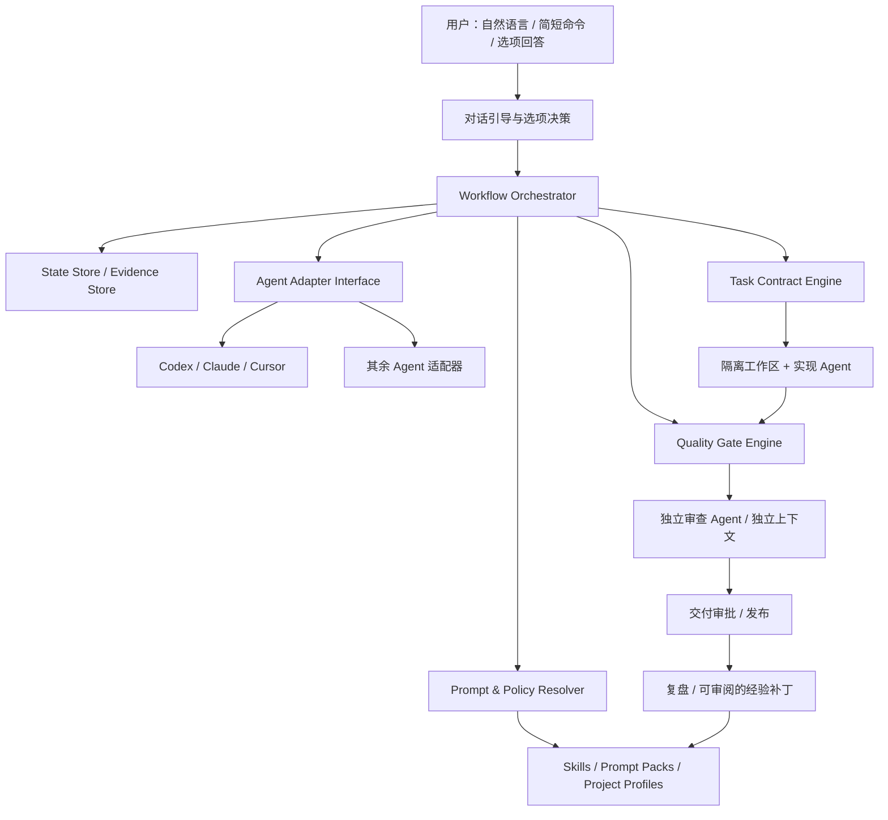

# AI-Native Engineering Kit — 跨 Agent 软件研发工程体系 PRD 与架构设计 V1.0

> 状态：方案草案 / 待项目级确认；版本：V1.0；日期：2026-11-17；拟用仓库名：`agent-engineering-kit`（工作名称，可修改）。
> 本文是可用于研发启动的设计基线，**不代表插件已实现、发布或经 14 个平台完成实测**。

## 0. 执行摘要

建立一套面向非专业用户、个人开发者和研发团队的软件工程闭环：**需求分析 → Spec → 技术设计 → 可执行任务契约 → Agent 实现 → 自动化验证 → 独立审查 → 交付验收 → 反馈改进**。新项目和老项目增量功能共用工程机制，适用 Web、前后端、全栈、桌面、移动端；用自然语言或短命令启动、少量高价值问答补全约束。核心采用**平台无关的工作流内核 + Agent Skills + 平台适配器 + 结构化证据与质量门禁**。

## 1. 目标、非目标与成功标准

### 1.1 业务目标

- G-001：用一句需求启动完整研发流程，用户无需逐阶段手工粘贴长 Prompt。
- G-002：所有阶段产物受版本管理、可追溯且可恢复；需求变更自动标注受影响的下游产物。
- G-003：工程规则跨 14 个目标 Agent 逐步扩展；优先保证 Codex、Claude Code、Cursor 等主流工具可靠运行。
- G-004：交付前获得可机器验证的证据（脚本退出码、测试报告、CI 状态、审查记录），拒绝以模型口头自检代替。
- G-005：同一套内核适配新建工程、现有项目功能、Bug 修复、重构；不同风险等级拥有不同审批和测试强度。

### 1.2 非目标

- N-001：MVP 不实现独立通用大模型服务、不托管用户代码、不自建跨所有 Agent 的云端执行平台。
- N-002：不承诺所有 Agent 的原生插件市场一键安装完全一致。以平台能力适配和实测分级为准。
- N-003：不把模型自主推断视为银行级、权限级、资金级业务规则的确认。
- N-004：不允许未经明确授权的生产发布、数据库破坏性操作、密钥读取与外发。
- N-005：MVP 不强制全仓统一技术栈；技术栈通过 Profile/Pack 扩展。

### 1.3 定量验收建议（提案阈值）

| 指标 | MVP 目标 | 验证方式 |
|---|---|---|
| 首次启动交互 | 用户只需一句需求 + 至多一轮必要选项澄清；阻塞问题可分轮 | 任务录屏/对话回放 |
| 需求追溯 | 每个功能需求有 FR-ID 与 AC-ID，交付任务和验证证据可回溯 | 自动审计脚本 |
| 流程恢复 | 中断后重新进入可定位到上一个持久化检查点 | 恢复用例 |
| 失败阻断 | lint/test/build/review 未满足策略时禁止自动标记为可交付 | 门禁单测与集成测试 |
| 兼容性 | MVP 对 Codex、Claude、Cursor 进行真实验收；其余分阶段接入 | 矩阵化冒烟测试 |
| 安全操作 | 生产部署、费用消耗、破坏性变更等由授权规则阻断 | 权限策略测试 |

## 2. 技术路线比较与选型

| 路线 | 内容 | 优点 | 缺点 | 判断 |
|---|---|---|---|---|
| A：纯 Prompt + Skills | 各平台分别安装静态 Skill | 成本低、传播快 | 状态恢复、质量门禁、证据收集不可靠 | 适合演示，不符合全部诉求 |
| **B：CLI 工程内核 + Skills + Adapters** | 确定性状态机、文件协议、平台技能入口、CI 校验 | 跨平台、离线优先、可测试、可组合 | 需适配器和测试矩阵 | **推荐** |
| C：本地/云端编排服务 + MCP | 统一运行 Agent、Web 控制台、多工调度 | 自动化潜力最大 | 复杂、安全成本高，平台依赖重 | V2 演进 |

**架构约束：** LLM 负责理解、提案、生成、审查意见；**确定性内核**拥有状态、签名、门禁、回滚、操作许可的最终判定权。模型不得通过修改流程状态文件自证通过。

## 3. 分层架构



### 3.1 最小实现模块

- **CLI Core**：`init`, `doctor`, `start`, `resume`, `status`, `ask`, `answer`, `gate`, `review`, `release`, `learn`, `install`, `verify-adapter`。
- **Orchestrator**：FSM 控制阶段推进、检查点、重试、受影响变更追踪；保持幂等。
- **Prompt Resolver**：由阶段模板 + 项目上下文 + 已确认决策 + 风险 Profile 组合系统提示词；所有注入都限定长度，来源可追踪。
- **Question Engine**：收集阻塞问题、给出 2～4 种明确不同的可选方案、推荐理由、影响范围和默认值；保留自由文本输入。
- **Contract Engine**：校验任务契约是否可执行、有完成定义、有允许修改范围和可运行测试。
- **Evidence/Gates**：存储执行命令、时间戳、退出码、环境、Commit SHA、测试文件和审查结论；允许重跑，不允许伪造通过状态。
- **Adapter SDK**：向不同 Agent 安装/渲染 Skills、规则、命令；能力发现，低保真适配时明确降级。
- **Profile Packs**：React/Vue、Spring Boot、Go、Rust、Python、Tauri/Electron、Flutter/React Native 等，不写死在内核。

## 4. 九阶段可恢复工作流与门禁

> 阶段状态：`pending -> active -> blocked|failed|passed -> approved -> next`。`failed` 可返回 `active` 重试，`blocked` 只在缺决策/外部依赖时使用；审批和通过是不同状态。核心产物须先满足客观校验才能通过。

| 阶段 | 输入 | 核心任务 | 必需产物 | 机器门禁 | 人工判断点 |
|---|---|---|---|---|---|
| P1 需求分析 | 自然语言、原型/接口/现有代码 | 场景、角色、权限、规则、异常、范围与不确定项 | `01-requirements/analysis.md`, `decisions.md` | 未解决阻塞问题为零 | 金融/安全/权限规则必须确认 |
| P2 Spec | 已确认需求 | FR-ID、NFR-ID、AC-ID、边界、追溯 | `01-requirements/spec.md` | ID 唯一、每项 FR 有 AC | 确认范围与验收标准 |
| P3 技术设计 | Spec、代码仓分析 | 架构、接口、模型、威胁、迁移、回滚 | `03-architecture/design.md`, `04-database/`, `05-api/` | 决策、风险、架构依赖齐全 | 高风险方案/跨服务接口决策 |
| P4 任务契约 | Spec、设计 | 有向无环依赖任务、单任务测试闭环 | `06-tasks/contracts/*.yaml`, `task-index.md` | schema 与依赖图合法、AC 覆盖 | 通常自动 |
| P5 Agent 实现 | 契约、现有仓 | 隔离分支/工作树、测试先行、最小变更 | 代码、测试、Commit、日志 | 无越权文件操作，任务证据完整 | 破坏性操作授权 |
| P6 自动测试 | 代码、契约 | lint、静态检查、单测、集成、E2E、构建、安全检查 | `07-verification/reports/`, `evidence.json` | 必填检查通过，失败自动修复限次 | 例外批准须留痕 |
| P7 独立审查 | diff、spec、证据 | 正确性、架构、安全、性能、可维护性 | `08-reviews/review-*.md` | Critical/High 阻断且需复核 | 安全风险/架构变更 |
| P8 交付验收 | CI、review、版本 | 验收回归、交付清单、发布/回滚 | `09-delivery/release-checklist.md`, `acceptance.md` | 满足 DoD、CI、验收证据 | 生产部署/对外交付审批 |
| P9 反馈改进 | 缺陷、审查、反馈 | 经验归因、补充模板或测试 | `10-feedback/lessons.md`, `improvement-proposal.md` | 更新已复核，不自改核心规则 | 接受公共 Skill/Prompt 变更 |

### 4.1 全流程与捷径模式

- **greenfield**：完整 9 阶段，新项目初始化、技术栈向导、基础设施与发布管线均在范围内。
- **feature**：先进行只读代码库勘测和影响分析，不强制覆盖现有 README/CI，继承仓库规范，继续完整逻辑闭环。
- **bugfix**：先要求复现和失败测试，可简化设计，但不能跳过质量证据与复核。
- **refactor**：必须定义行为不变的基线与回归测试；有重大架构变更则升级完整设计。
- **hotfix**：采用紧急门禁 Profile 缩短流程，可延后文档补齐，但不能取消关键自动校验和审批。

### 4.2 变更管理

对 `spec.md`、`design.md`、任务契约保存 SHA256；任一上游材料修改时，将依赖它的下游状态标为 `stale`，按影响范围重新评审、再测。避免“代码和 Spec 已经偏离，但流程依然显示完成”。

## 5. 傻瓜式问答设计

### 5.1 用户只需说

- `帮我做一个员工请假系统。`
- `给这个企业邮箱新增附件批量下载。`
- `修复登录后偶发白屏的问题。`
- `继续上次未完成的任务。`

### 5.2 交互原则

1. 优先自动探测仓库与用户提供的材料；**已知不重复问**。
2. 对不影响结果的细节使用可说明的工程默认值；对金额、权限、安全、数据保留、法规等高影响规则**不得默默假设**。
3. 每轮尽量 1～3 个高优先级问题；先给推荐选项和取舍，再给“其他/自行描述”。
4. 允许「推荐方案」「全部按默认」「高级模式」等快捷输入；允许任何时候修改已确认的选择并触发失效追踪。
5. 明确显示“为何需要回答”“不答会影响什么”“下一步将生成什么”；使用用户可懂的表达，不强制理解 PRD/DDD/CI 等术语。
6. 对模型推断输出置信度，但**置信度不代替用户授权**。

### 5.3 选项化决策样例

```yaml
id: DEC-API-001
phase: design
question: "这个系统是否需要前后端分离？"
why: "会决定项目目录与部署方式"
blocking: true
options:
  - id: A
    label: "前后端分离（推荐）"
    pros: ["便于扩展和独立部署"]
    cons: ["需要维护两个应用"]
  - id: B
    label: "单体 Web 应用"
    pros: ["初期开发部署简单"]
    cons: ["未来拆分有成本"]
  - id: C
    label: "沿用现有项目结构"
    pros: ["改动小"]
    cons: ["受现有架构限制"]
recommended: C
recommendation_reason: "当前是已有项目增量开发，兼容性优先"
free_text_allowed: true
```

**注意：** 针对全新项目的样例，推荐项可调整为 A；推荐必须由上下文和策略计算，不能永远固定。

## 6. 可执行任务契约

每个 Task 是可独立实现、测试、复核的最小闭环，不能简单写“完成用户管理模块”。最低字段示例：

```yaml
schema_version: "1.0"
id: TASK-API-001
name: "实现员工请假申请创建接口"
mode: feature
status: ready
spec_version: "1.0"
requirements: [FR-003]
acceptance_criteria: [AC-FR-003-01, AC-FR-003-02]
depends_on: [TASK-DB-001]
inputs:
  - docs/01-requirements/spec.md
  - docs/03-architecture/design.md
  - docs/05-api/openapi.yaml
allowed_paths:
  - services/api/src/**
  - services/api/test/**
forbidden_paths:
  - .env*
  - secrets/**
preconditions:
  - "数据库迁移基线已建立"
steps:
  - "先添加失败的接口/业务校验测试"
  - "实现最小业务逻辑"
  - "运行接口测试与静态检查"
verification:
  commands:
    - "./scripts/test-api.sh"
    - "./scripts/lint-api.sh"
  expected:
    - "测试命令退出码 0"
    - "返回值符合 OpenAPI 与 AC"
review:
  dimensions: [correctness, security, testability]
  require_independent_context: true
risk: medium
autonomy: supervised
max_repair_attempts: 3
rollback: "撤销当前任务提交，保留审计日志"
done_when:
  - "AC 已映射到可执行测试"
  - "自动测试通过且证据已归档"
  - "独立审查无未解决 High/Critical 问题"
```

### 6.1 契约语义

- `allowed_paths` 代表允许修改的范围，但不能仅靠 Prompt 约束；执行器需要检查真实 diff。
- `verification.commands` 必须在可信环境执行并记录退出码；不能将模型自述“已通过”当作测试证据。
- 文件改动越界、依赖未完成、需求状态过期，均阻断进入下一阶段。
- 修复循环 `max_repair_attempts` 有上限，连续失败转为人类可读的阻塞报告，而不是无限耗费 Tokens。
- 单个契约既能在同一 Agent 中顺序执行，也能映射给可用子 Agent/工作树并行执行；依赖有向无环才能并行。

## 7. Prompt 系统与上下文装配

### 7.1 Prompt 分层

```text
core-system.md                 不能越权、证据优先、按状态机执行
policies/<risk-profile>.md    当前项目风险与审批策略
stages/<phase>.md             该阶段具体目标、输入/输出/步骤
profiles/<stack>.md            语言/架构/框架约束
project/context.md             仓库事实（读取，不杜撰）
project/decisions.md           用户已确认决策
schemas/<artifact>.schema.json 输出机器可校验 Schema
```

禁止把所有 Prompt 和所有技术栈知识一次注入上下文；采用 Agent Skills 渐进加载、按阶段解析、引用明确版本。

### 7.2 P1 需求分析完整内置 Prompt

> 角色：资深产品架构师兼业务分析师。当前处于需求分析，不得编写业务实现代码，不得凭空确定重要技术实现。
>
> **输入准备**：读取用户原始需求、附件、原型、已有项目 README/接口文档及仓库实际结构；区分“事实”“用户已确认决定”“合理建议”“尚未确认假设”。
>
> **工作步骤**：
> 1. 概括业务目标、成功指标、参与人员、利益相关方和使用场景。
> 2. 明确用户角色、租户/部门/组织关系、权限边界和数据权限。
> 3. 提取核心业务实体、完整功能需求、业务规则及依赖。
> 4. 枚举主流程、备选流程、异常/失败流程、回退流程、重复提交、并发场景、输入输出边界。
> 5. 识别 NFR：安全、可靠性、性能、可访问性、可维护性、可观测性、合规与隐私。
> 6. 检查需求重复、歧义、矛盾、缺失及与现存系统的冲突；指出需要业务负责人裁决的规则。
> 7. 定义本次范围、非目标、对外依赖、明确不包含的功能和上线约束。
> 8. 对未知问题分为：阻塞型（影响用户、钱、权限、安全、数据）与非阻塞型（可使用标注默认值）。
> 9. 对阻塞问题生成选项式问答，2～4 个互斥或差异明显的方案，说明适用条件、收益、代价、推荐理由；每轮优先问最关键的问题。
> 10. 依据回答更新决定记录，重复步骤 1～9，直到阻塞问题解决。
>
> **输出约束**：先生成 `docs/01-requirements/analysis.md` 和 `decisions.md`，在用户确认后生成/完善 `spec.md`。每条 FR、NFR、AC 使用稳定且唯一 ID；每个 FR 必须有至少一个可客观判定的 AC；不得以“操作正常”“界面友好”作为唯一验收标准。
>
> **完成条件**：FR→AC 可追溯，范围完整，阻塞问题为 0，所有关键业务决策有来源和日期；运行 Schema/ID/引用检查。未满足则留在本阶段并说明具体阻塞项。

### 7.3 P2 Spec Prompt

> 角色：软件规格分析师。严格基于已确认的 `analysis.md` 和 `decisions.md`，建立实现无关、可测试的 `spec.md`。按模块分组，每项含 ID、角色、前置条件、触发、主流程、异常流程、业务规则、边界与 AC。NFR 给出可测数值或明确验证方法；生成范围/非目标、术语、开放问题、需求关联矩阵。检查每项 FR→AC、业务规则→测试意图的覆盖；不要将尚未确认的推断升级为需求。若需求变化则标记下游产物失效。执行 spec 校验，失败自动补全并重试，不得未经验证推进。

### 7.4 P3 技术设计 Prompt

> 角色：解决方案架构师、技术负责人和安全设计师。阅读 Spec、现有代码、组织约束。比较 2～3 种可落地方案，包括沿用现状与成本较低方案；给出推荐理由和架构决策记录 ADR。形成系统上下文、组件图、部署图、关键时序、数据模型、权限模型、接口契约、异常处理、性能容量、日志监控、安全威胁、迁移与回滚、兼容性策略、技术债清单。若已有项目，优先兼容现有结构，不擅自迁移技术栈。所有高影响假设提问后再确定。产物与需求 ID 互相链接，设计校验通过后推进。

### 7.5 P4 任务拆解 Prompt

> 角色：技术项目经理与高级工程师。把经确认的 Spec/设计拆为可独立提交、测试和审查的任务契约。每个任务仅承载一个可独立检验的交付成果；包含唯一 ID、输入、依赖、文件边界、接口、验收 ID、最小测试、运行命令、回滚、风险与所需权限。按依赖排序，能并行的任务给出互不冲突的变更范围，不能并行则串行。每条 AC 必须被至少一个任务与至少一个验证方法覆盖。生成 YAML 契约索引并运行 schema、依赖环和覆盖检查。

### 7.6 P5 Agent 实现 Prompt

> 角色：实现工程师。仅处理已激活且依赖满足的一个任务契约。先读取关联 Spec/设计/现有规范，检查工作区干净、分支/工作树隔离，完成可复现失败测试，再做最小实现。严格控制 allowed_paths，不能修改敏感目录、生产数据或未授权服务；遇到新需求/设计冲突停止并产生阻塞决策，不私自扩范围。测试失败按诊断—修复—复测闭环，记录执行命令和输出。成功后提交变更与证据，不自行批准独立审查。

### 7.7 P6 自动验证 Prompt

> 角色：自动化测试工程师与质量工程师。根据任务契约、FR/AC、NFR 和风险等级构建验证矩阵。优先运行小范围快反馈检查，再运行全量影响域检查：lint、typecheck、单元、接口/集成、E2E、构建、依赖安全、必要性能和迁移回滚。验证脚本、配置与运行环境应写入证据。只有客观执行结果为通过且覆盖全部要求时才签发 gate PASS；出现失败时输出最小复现、定位文件与失败证据，并将任务退回实现阶段，在限定次数内重试。

### 7.8 P7 独立审查 Prompt

> 角色：独立代码审查员；与实现者隔离上下文，优先用独立 Agent 实例/模型。只读 Spec、契约、Diff、测试证据，不能信任实现者的自述。按正确性、业务规则、边界条件、异常处理、安全/越权、并发一致性、性能、可测试性、可维护性审查。每项问题必须说明级别（Critical/High/Medium/Low）、文件位置、影响、复现与修复建议。不能凭主观喜好阻断；不得直接修改源代码或伪造验收证据。High/Critical 未关闭则 FAIL；修复后重新验证和复审，保留所有回合记录。

### 7.9 P8 交付验收 Prompt

> 角色：发布经理兼验收负责人。根据已通过的 Spec、任务清单、CI 和独立审查记录生成完整交付清单，包含版本、Commit SHA、变更摘要、部署和配置说明、数据库迁移/回滚、操作手册、已知风险与验收记录。对 AC 按实际执行证据逐条标记通过/未通过，不用笼统的“已完成”。生产发布、对外发送和数据变更需符合审批策略；未授权时仅输出待批准的发布计划。交付结果回写版本与状态。

### 7.10 P9 反馈改进 Prompt

> 角色：持续改进工程师。收集用户反馈、审查缺陷、测试失败、返工和耗时数据。对每项问题标注事实、影响、根因和可复现证据；区分项目特有知识与跨项目通用知识。提出对 Prompt、Skills、Schema、Profile、测试或文档的改进补丁，给出反例和回归测试；绝不自动把未经验证的一次性偏好写入全局 Skill。对改进运行对照测试与用户复核，再版本化发布。形成 lessons learned 和变更建议。

## 8. 阶段产物与统一目录（建议）

```text
agent-engineering-kit/                   # 研发插件源码仓库
├── README.md                            # 用户入口与示例
├── README.zh-CN.md                      # 中文用户手册
├── LICENSE                              # 开源许可
├── package.json                         # CLI 发布入口（若采用 TS）
├── packages/
│   ├── core/                            # 状态机、流程、策略、证据、契约
│   ├── cli/                             # init/start/resume/install/doctor 等命令
│   ├── adapter-sdk/                     # Agent 能力与安装器接口
│   └── adapters/                        # 各 Agent 的规则/命令/路径适配
├── skills/                              # 平台中立 Agent Skills 源文件
│   ├── ai-start/SKILL.md               # 一句话启动向导
│   ├── ai-discover/SKILL.md            # 只读项目勘察
│   ├── ai-requirements/SKILL.md        # 需求分析及澄清
│   ├── ai-spec/SKILL.md                # 可验收规格
│   ├── ai-design/SKILL.md              # 技术设计与 ADR
│   ├── ai-plan/SKILL.md                # 任务契约
│   ├── ai-build/SKILL.md               # TDD 实现
│   ├── ai-verify/SKILL.md              # 自动验证
│   ├── ai-review/SKILL.md              # 独立审查
│   ├── ai-ship/SKILL.md                # 交付与发布
│   ├── ai-learn/SKILL.md               # 复盘与优化
│   └── ai-resume/SKILL.md              # 状态恢复
├── prompts/
│   ├── core/                            # 全局执行和安全约束
│   └── stages/                          # 01~09完整 Prompt，Skill 按需引用
├── templates/
│   ├── project/                         # 标准项目目录与规则模板
│   ├── artifacts/                       # PRD、Spec、ADR、接口、数据库、验收
│   └── contracts/                       # 任务契约与复核记录
├── schemas/                             # JSON Schema 等确定性校验规则
├── profiles/                            # 前端、后端、移动端、桌面端等技术栈包
├── policies/                            # 风险等级、自动化授权、安全边界
├── scripts/                             # CI 检查器、安装器、检测脚本
├── examples/
│   ├── greenfield-web-admin/           # 从零启动案例
│   ├── existing-mail-feature/          # 企业邮箱功能案例
│   └── regulated-finance/              # 强审查/合规场景案例
├── tests/
│   ├── core/                            # 状态/契约/策略单测
│   ├── skills/                          # 基线对照压力测试
│   ├── adapters/                        # 平台实测矩阵
│   └── e2e/                             # 端到端恢复/交付测试
├── docs/
│   ├── 01-requirements/                # 产品 PRD、规格与需求追溯
│   ├── 02-product-design/              # 对话向导原型与可用性设计
│   ├── 03-architecture/                # 架构设计与 ADR
│   ├── 04-database/                    # 状态存储模型（如使用数据库）
│   ├── 05-api/                         # CLI/Adapter/MCP 接口契约
│   ├── 06-tasks/                       # 实施任务与可执行契约
│   ├── 07-verification/                # 测试方案与证据规则
│   ├── 08-reviews/                     # 安全、质量、代码审查
│   ├── 09-delivery/                    # 安装、发布、验收手册
│   └── 10-feedback/                    # 经验沉淀与改进记录
└── .github/workflows/                  # GitHub Actions CI
```

**在使用插件的业务项目中，安装器应只增补以下工程层，不重写业务源码：**

```text
existing-or-new-project/
├── AGENTS.md                            # 通用 Agent 项目规则，短小
├── CLAUDE.md                            # Claude 定制入口/引用
├── .agents/skills/                     # 平台中立 SKILL.md 或引用
├── .ai-engineering/
│   ├── config.yaml                      # 项目风险、技术栈、授权策略
│   ├── state.json                       # 内核管理的当前阶段与检查点
│   ├── decisions.yaml                   # 用户决策与来源
│   ├── manifests/                       # 产物哈希和版本关联
│   └── evidence/                        # 自动执行证据（敏感数据脱敏）
├── docs/
│   ├── 01-requirements/                # analysis / spec / decisions
│   ├── 02-product-design/              # 原型与交互稿
│   ├── 03-architecture/                # design / ADR / diagrams
│   ├── 04-database/                    # 数据模型、DDL 与迁移策略
│   ├── 05-api/                         # OpenAPI、接口错误码与契约
│   ├── 06-tasks/contracts/             # 可执行任务契约 YAML
│   ├── 07-verification/                # 测试计划/报告/验证证据
│   ├── 08-reviews/                     # 审查结果与修复复核
│   ├── 09-delivery/                    # 验收与发布
│   └── 10-feedback/                    # 复盘与经验改进
└── .github/workflows/                  # 可选安装 CI 门禁，不覆盖已有流程
```

**设计说明：** 原仓库已有 `docs/` 命名惯例时优先合并；不得在未确认时大规模移动目录。运行时历史执行日志可写在忽略目录，审计摘要与非敏感元信息可纳入 Git。

## 9. Agent 支持策略与兼容矩阵

定义三个层级：**S1 Skills 加载**（找到并激活）、**S2 规则与短命令**（Agent 平台原生适配）、**S3 可靠自动闭环**（真实仓库端到端状态恢复、CI、审查和授权都通过）。S1 不等于 S3。以下目录参考官方公开文档，具体适配需逐版本验证。

| Agent | 主要 Skills 位置 / 导入方式 | 验证建议 |
|---|---|---|
| OpenAI Codex | `.agents/skills/`；`AGENTS.md` | MVP 首批 S3 |
| Claude Code | `.claude/skills/`；`CLAUDE.md`；Hooks/Subagents | MVP 首批 S3 |
| Cursor | `.agents/skills/` 或 `.cursor/skills/`；`.cursor/rules/` | MVP 首批 S3 |
| OpenCode | `.agents/skills/` 或 `.opencode/skills/`；`AGENTS.md` | 次批 S3 |
| Kilo Code | `.kilo/skills/` 及平台兼容路径（版本检查） | 次批 S2/S3 |
| Gemini CLI | `.gemini/skills/` 或 `.agents/skills/`；`GEMINI.md` | 次批 S3 |
| GitHub Copilot | `.github/skills/` / `.agents/skills/`；`.github/copilot-instructions.md` | 次批 S3 |
| Google Antigravity | `.agents/skills/`；Agent/IDE 版本区分 | 次批 S2/S3 |
| TRAE | `.trae/skills/` 或启用的 `.agents/skills/` | 次批 S2/S3 |
| CodeBuddy | `.codebuddy/skills/`；其自身 Plugin 格式 | 次批 S2/S3 |
| WorkBuddy | Skills/MCP/Hook/Agent/Rule 插件系统，优先以官方插件机制分发 | 独立适配验证 |
| Cline | `.cline/skills/` / 个人目录（依平台版本） | 次批 S2/S3 |
| Qoder | `.qoder/skills/` 或市场导入与兼容目录 | 次批 S2/S3 |
| Windsurf | 文档与发行版本变化较快；探测兼容 Skills 和本地命令能力 | 先 POC，不承诺 S3 |
| Augment | 已有 Skills 迹象，安装路径/权限/命令接口需单独官方核验 | 先 POC，不承诺 S3 |

> 用户列出 14 种工具，但 CodeBuddy/WorkBuddy 是两种面向不同场景的表面，本表拆开列项。**不应统一宣称“14 个工具完全适配”**，尤其要区别 CLI、IDE、云端 Agent、WorkBuddy 的运行和本地文件访问权限。

### 9.1 一次编写、多目标分发

- 以 `skills/<name>/SKILL.md` 作为唯一权威内容源，不重复维护 14 份 Prompt。
- `adapter` 包含 `detect()`, `capabilities()`, `render()`, `install()`, `verify()`，由内核根据平台输出安装目录、规则文件、命令入口和权限提示。
- 适配器将生成的二级文件视为可重建产物；禁止用户编辑源、衍生文件后不同步。
- 对无可用 shell、缺少文件写入、无法启动独立子 Agent 的平台，明确降级：只生成产物、运行外部 CI 或要求用户确认，不虚假报告自动闭环。

## 10. 质量门禁与证据协议

### 10.1 门禁分层

| 级别 | 用途 | 必备要求 |
|---|---|---|
| Basic | 个人原型 | lint（如适用）、类型/静态检查、单测、构建、需求-验收对应 |
| Standard | 企业生产项目 | Basic + 接口/集成测试 + 独立审查 + SCA/Secret Scan + CI |
| Regulated | 银行业务/高风险系统 | Standard + 威胁建模 + 权限/数据隔离 + 审计 + 安全测试 + 发布审批 + 回滚演练 |

### 10.2 CI 推荐门禁

- `schema-validate`: YAML/JSON Schema、Spec ID 唯一、FR→AC→Task→Test 映射完整。
- `format-lint`: 格式与 lint，禁止新增未处理的严重静态问题。
- `typecheck-build`: 语言类型检查与可重复构建。
- `unit-integration-e2e`: 根据实际项目可靠脚本运行，不假定所有项目都有前端 E2E。
- `security`: secret scanning、依赖漏洞扫描、适用时 SAST；阻断阈值可配置但保留理由。
- `review-gate`: 独立审查结论和已关闭的 High/Critical 问题。
- `release-gate`: 仅对通过 CI 且获得授权的候选提交打版本/部署。

### 10.3 证据结构

```json
{
  "schema_version": "1.0",
  "task_id": "TASK-API-001",
  "commit_sha": "<actual git commit>",
  "gate": "unit-integration",
  "runner": "github-actions",
  "command": "./scripts/test-api.sh",
  "exit_code": 0,
  "started_at": "<ISO timestamp>",
  "finished_at": "<ISO timestamp>",
  "artifact_path": "docs/07-verification/reports/task-api-001.xml",
  "artifact_sha256": "<actual SHA256>",
  "status": "passed"
}
```

不可由 Agent 写入上例占位内容冒充证据；可信执行器必须填写实际数值与可验 hash。项目本地日志需脱敏并防止 `.env`、票据等进入 Git。

## 11. Git 分支、工作树与多 Agent 协作

- 主干：`main` 始终应保持可构建；可选 `develop`，默认推荐 Trunk Based + 短分支。
- 功能：`feat/FR-003-short-title`；缺陷：`fix/BUG-021-short-title`；紧急：`hotfix/INC-023`。
- 并行：一个执行任务对应独立 git worktree/branch；允许多个 Agent 并行只在任务依赖与修改范围明确不冲突时开启。
- 提交：Conventional Commits，Commit/PR 正文引用 FR、AC、TASK；PR 含证据摘要与风险信息。
- 审查隔离：实现者不能自签独立审查；没有原生子 Agent 时使用独立新会话/不同模型/CI Reviewer，不能因工具不支持就将自检称作“独立审查”。
- 保护：PR 合并前强制 CI/审查；保护分支不允许绕过；最终合并、生产发布按策略授权。

## 12. 自动化授权模型

| 级别 | 名称 | 可自动做 | 需许可 |
|---|---|---|---|
| L0 | 只读 | 代码检索、分析、报告 | 写入仓库 |
| L1 | 安全自动 | 在隔离分支创建文件、运行本地测试、修复、复测 | 外网请求、数据修改、费用性 API |
| L2 | 监督实现 | 经批准的变更、PR 创建、非生产测试环境部署 | 受保护分支合并、对外发送、生产变更 |
| L3 | 明示授权 | 明确范围内的发布/迁移/对外调用 | 超出此次授权范围的操作仍需新审批 |

默认个人项目可为 L1；企业生产项目为 L1/L2；高风险系统强制发布审批。绝不将 `approval_policy=never` 等同于业务层无限授权。任何工具执行应受系统/宿主权限机制限制，内核策略是第二道门禁。

## 13. 新项目与既有项目完整操作示例（目标用户体验）

### 13.1 新项目：请假系统

1. 用户输入：`做一个员工请假管理系统，Web 中后台，支持申请、审批、查询。`
2. `ai-start` 自动识别 greenfield，选项询问：仅企业内部使用还是多租户？审批层级？是否接入已有组织系统？
3. 对一般技术栈给出推荐，用户可选“按推荐方案执行”；关键权限审批规则确认后自动生成需求分析和 Spec。
4. 自动生成设计/ADR/任务契约，逐任务实现与验证；出现业务冲突时回到问答，不让模型自造规则。
5. Gate PASS 且独立审查通过后生成验收清单；请求部署授权，获准才执行发布。
6. 记录回归缺陷和通用改进建议，但不未经复核改写全局插件。

### 13.2 现有企业邮箱：附件批量下载

1. 用户输入：`在现有邮箱邮件列表中增加附件批量下载。`
2. 先只读分析 UI 状态、现有 API、附件模型、权限范围、已有测试和构建工具。
3. 只问影响实际业务的规则：是否跨邮件批量下载、文件上限、打包逻辑、单附件权限、断点续传、失败报告。
4. 任务契约仅允许相关页面/接口/测试范围；遵循现有技术栈，不改造整个前端框架。
5. 自动执行 lint/typecheck/单测/接口/适用时 E2E，并让独立 reviewer 检查越权下载、下载文件名注入、资源耗尽。
6. 生成增量 PR、验收清单和回退方案。

## 14. MVP 范围、顺序与里程碑

### M0：设计与协议基线

完成：规范、状态机、任务契约 Schema、风险策略、完整 Prompt、Question Engine 对话原型、真实项目用例集。验收：需求和设计的边界清楚，文档审查通过。

### M1：可用的单机工程内核

支持：Node.js/TypeScript CLI 或 Python CLI（二选一，推荐 TypeScript），初始化已有仓库、创建增量任务、保存/恢复状态、文档 ID 校验、契约校验、阶段门禁、测试命令执行与证据归档。验收：断点恢复、失效追踪、失败阻断集成测试通过。

### M2：前三类 Agent 适配

为 Codex、Claude Code、Cursor 生成 Skills 和规则/命令入口，完成从一句需求到本地可验 PR 的 E2E 演示；至少覆盖一个 greenfield 和一个 legacy feature。验收：实际在三平台执行并存档结果，不只校验目录存在。

### M3：扩展适配与发行

增加 OpenCode、Gemini CLI、Copilot、Antigravity、TRAE、CodeBuddy、Kilo、Cline、Qoder 等适配器；Windsurf/Augment/WorkBuddy 做独立 POC。加入 NPM/二进制/插件市场分发策略。验收：每个平台按照能力矩阵打分并公布限制。

### M4：增强编排与运营

可选 MCP 桥接、可视化 Dashboard、多人协作、变更回放、成本统计、跨模型独立评审、Prompt/Skill 回归评测平台。纳入独立版本线，避免阻塞 MVP。

## 15. 典型风险与应对

- **Prompt 不可靠**：状态机、Schema、真实命令与 Git/CI 门禁做硬约束；禁止模型“宣告已通过”。
- **工具差异**：先做能力探测与细粒度平台适配；不同平台降级，而非强求功能一致。
- **上下文污染**：仅注入当前阶段相关材料，避免把全部文档塞进单个 Prompt；每阶段读取经确认版本。
- **成本失控**：限制审查次数、修复轮次、子 Agent 并发、上下文/token 预算；超预算生成阻塞报告。
- **业务错误**：关键规则与验收标准由用户授权，不随“推荐方案”自动确认。
- **数据泄露**：默认离线文件工作流、敏感目录 denylist、证据脱敏、外发需授权。
- **产物过量**：按任务规模采用 Full/Lean 两种 Artifact Profile；功能小改不强制十份冗长文档。
- **升级破坏**：生成文件带源版本和迁移策略；安装器采用 plan/preview/diff，先备份再合并。

## 16. 待决策项（均有推荐默认）

| 编号 | 决策 | 推荐 | 原因 |
|---|---|---|---|
| DEC-001 | 产品名 | `agent-engineering-kit` 暂用 | 不过早被框架或语言绑定 |
| DEC-002 | 内核语言 | TypeScript + Node 22+ | 生态、CLI/JSON Schema、跨平台部署和 npm 分发便利 |
| DEC-003 | 状态存储 | JSON + append-only events，后续可转 SQLite | MVP 无依赖、易排错、可搬迁；并发写需文件锁 |
| DEC-004 | 安装策略 | 项目级优先，个人全局可选 | 避免污染其他项目和版本冲突 |
| DEC-005 | 默认安全级别 | L1 + Standard，可按项目 Profile 调整 | 平衡自动化、可控性和审计 |
| DEC-006 | 独立审查 | 独立新会话/Agent；高风险可多 Reviewer | 避免实现者审查自身 |
| DEC-007 | 最小平台集合 | Codex、Claude、Cursor | 先有真实端到端可用性再扩展 |

## 17. 资料来源与兼容性参考（2026-11-17 检索）

- Agent Skills 开放标准：https://agentskills.io/specification
- Codex 指引：https://learn.chatgpt.com/docs/customization/overview
- Claude Code：https://claude.com/resources/articles/steering-claude-code-skills-hooks-rules-subagents-and-more
- Cursor：https://cursor.com/docs/skills
- OpenCode：https://opencode.ai/docs/skills/
- Kilo：https://github.com/Kilo-Org/kilocode/blob/main/packages/kilo-docs/pages/customize/skills.md
- Gemini CLI：https://github.com/google-gemini/gemini-cli/blob/main/docs/cli/skills.md
- GitHub Copilot：https://docs.github.com/en/copilot/how-tos/copilot-on-github/customize-copilot/customize-cloud-agent/add-skills
- Antigravity：https://antigravity.google/docs/skills
- TRAE：https://docs.trae.cn/ide_skills
- CodeBuddy：https://www.codebuddy.cn/docs/ide/Features/Skills
- WorkBuddy：https://www.codebuddy.cn/docs/workbuddy/Plugins
- Qoder：https://docs.qoder.com/qoder/skills
- Cline：https://github.com/cline/cline/blob/main/docs/customization/skills.mdx

> 目录与功能随平台版本变化。本文只说明已查到的公开能力与设计建议，**未进行这些平台上的本机真实安装与完整 E2E 测试**。GitHub 上的官方项目文档仅作为公开资料参考，并非操作用户 GitHub 账户。
